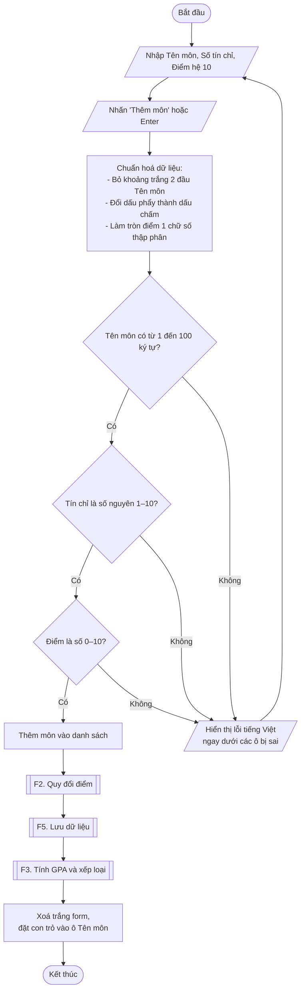
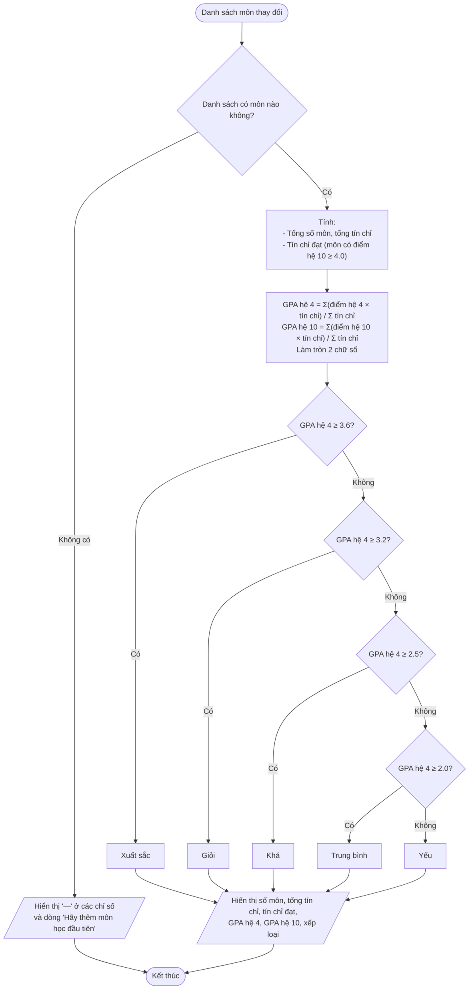
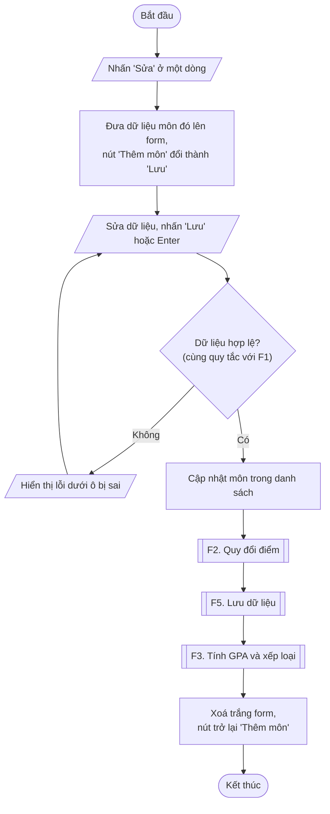
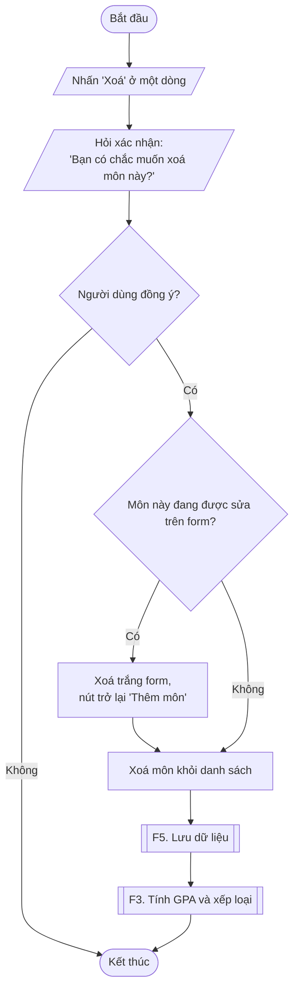
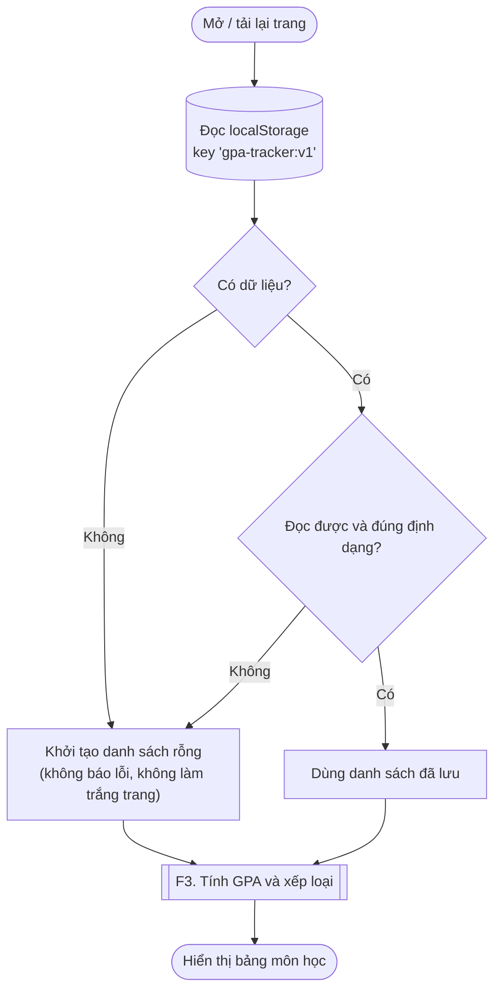
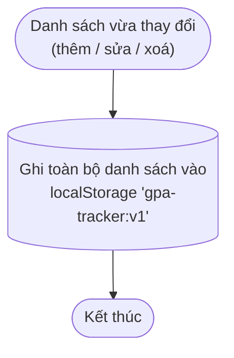
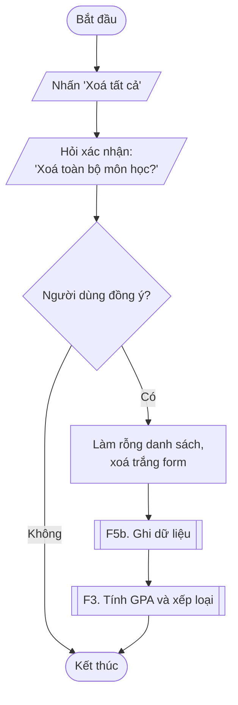

# Luồng nghiệp vụ – GPA Tracker

Thiết kế từ `PRD.md`. Ký hiệu dùng trong sơ đồ:

| Hình | Ý nghĩa |
|------|---------|
| Hình viên thuốc | Bắt đầu / Kết thúc |
| Hình bình hành | Người dùng nhập / hệ thống hiển thị |
| Hình chữ nhật | Hệ thống xử lý |
| Hình thoi | Điều kiện rẽ nhánh |
| Hình chữ nhật viền đôi | Gọi sang luồng chức năng khác |
| Hình trụ | Bộ nhớ trình duyệt (localStorage) |

---

## F1. Thêm môn học

> Ghi chú: hệ thống kiểm tra cả 3 ô rồi mới hiện lỗi, nên người dùng thấy tất cả lỗi cùng một lúc, không phải sửa từng ô một.

---

## F2. Quy đổi điểm

---

## F3. Tính GPA và xếp loại

> Ghi chú: xếp loại dựa trên GPA hệ 4 **sau khi đã làm tròn** 2 chữ số. Ví dụ 3.596 làm tròn thành 3.60 nên được xếp Xuất sắc.

---

## F4. Sửa môn học

## F4. Xoá môn học

---

## F5. Lưu dữ liệu

### F5a. Tải dữ liệu khi mở trang

### F5b. Ghi dữ liệu sau mỗi thay đổi

### F5c. Xoá tất cả

---

## Các điểm PRD chưa nói rõ (đề xuất xử lý)

| # | Tình huống | Đề xuất |
|---|-----------|---------|
| 1 | Xoá đúng môn đang được sửa trên form | Xoá trắng form, nút trở lại "Thêm môn" (đã vẽ trong F4. Xoá) |
| 2 | Đang sửa mà muốn bỏ, không sửa nữa | Thêm nút "Huỷ" cạnh nút "Lưu" |
| 3 | Bấm "Xoá tất cả" khi danh sách đang rỗng | Làm mờ nút, không bấm được |
| 4 | Nhập điểm dạng 8.45 | Làm tròn thành 8.5 rồi mới quy đổi, nên ra điểm A |
