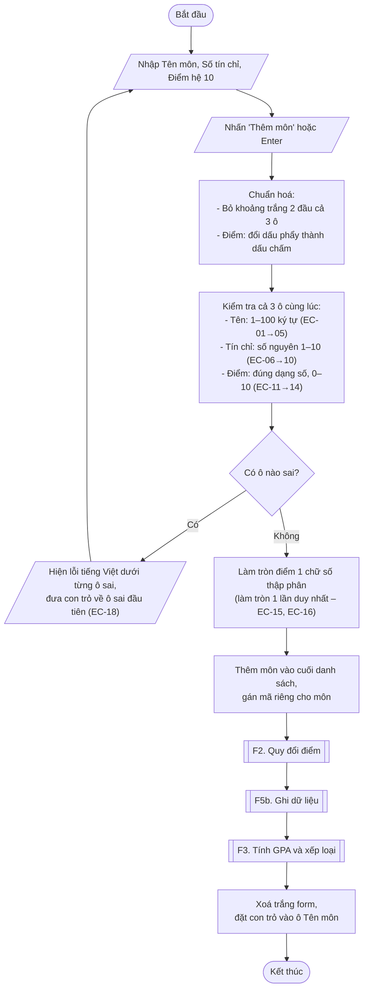
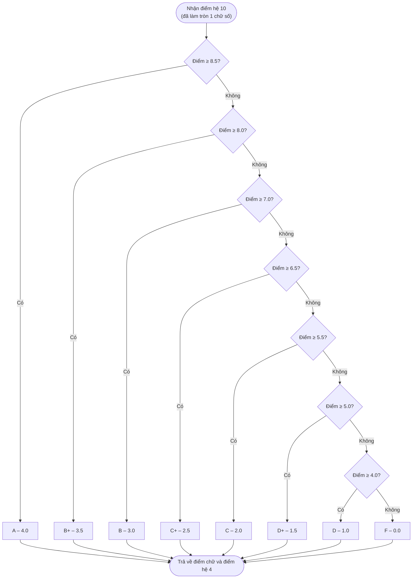
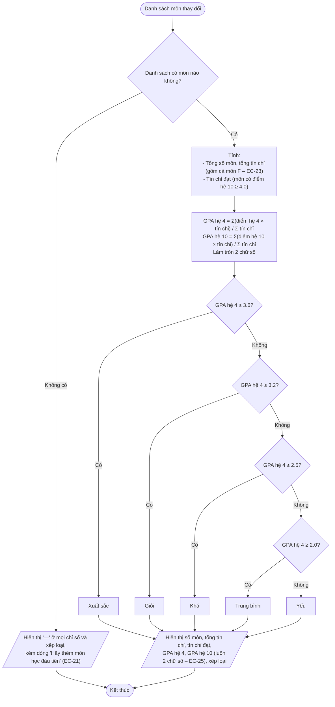
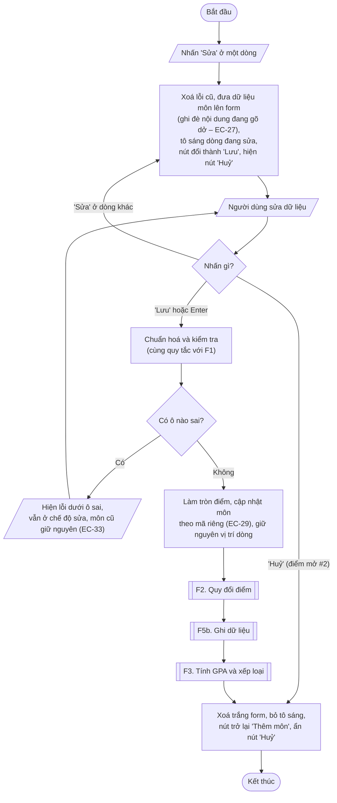
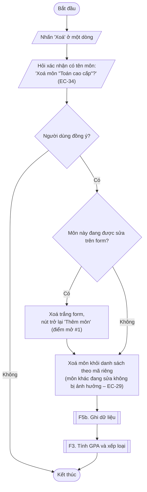
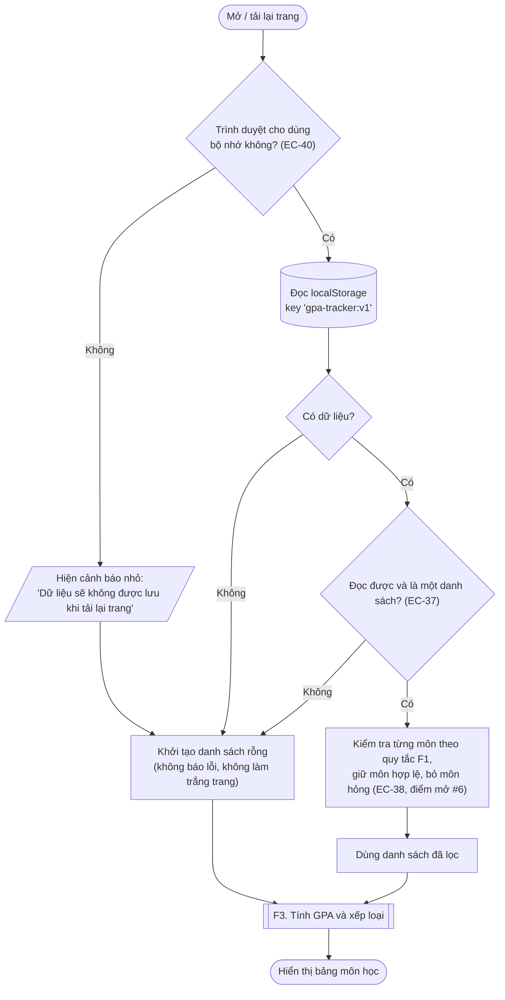
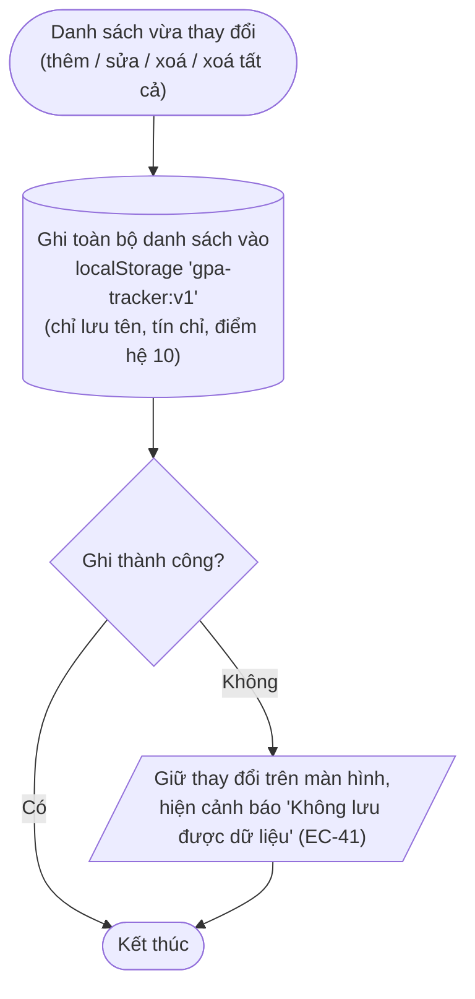
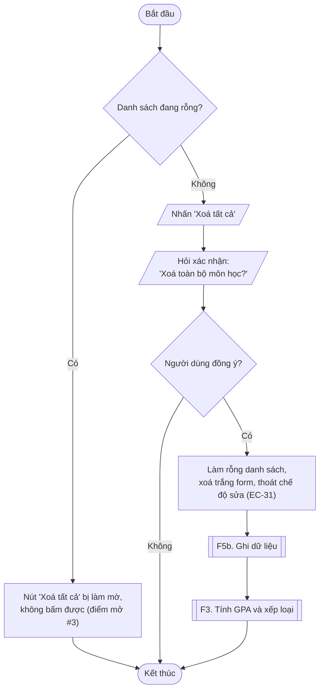

# Luồng nghiệp vụ – GPA Tracker

Thiết kế từ `PRD.md` (đã chốt ngày 2026-10-07). Ký hiệu dùng trong sơ đồ:

| Hình | Ý nghĩa |
|------|---------|
| Hình viên thuốc | Bắt đầu / Kết thúc |
| Hình bình hành | Người dùng nhập / hệ thống hiển thị |
| Hình chữ nhật | Hệ thống xử lý |
| Hình thoi | Điều kiện rẽ nhánh |
| Hình chữ nhật viền đôi | Gọi sang luồng chức năng khác |
| Hình trụ | Bộ nhớ trình duyệt (localStorage) |

Mã `EC-xx` trong sơ đồ trỏ tới bảng **Edge cases** ở cuối tài liệu. Các mã này sẽ được dùng lại khi viết test tự động và bảng test case.

---

## F1. Thêm môn học

> Ghi chú:
> - Điểm được kiểm tra khoảng 0–10 **trên số người dùng gõ**, trước khi làm tròn. Vì vậy 10.01 bị báo lỗi, không bị làm tròn thành 10.0.
> - Lỗi của ô nào sẽ biến mất khi người dùng sửa ô đó (EC-19).

---

## F2. Quy đổi điểm

> Ghi chú: điểm chữ và điểm hệ 4 **không lưu lại**, mỗi lần hiển thị đều tính lại từ điểm hệ 10 (EC-39). Nhờ vậy dữ liệu luôn khớp với bảng quy đổi.

---

## F3. Tính GPA và xếp loại

> Ghi chú: xếp loại dựa trên GPA hệ 4 **sau khi đã làm tròn** 2 chữ số. Ví dụ 3.596 làm tròn thành 3.60 nên được xếp Xuất sắc (EC-24).

---

## F4. Sửa môn học

## F4. Xoá môn học

---

## F5. Lưu dữ liệu

### F5a. Tải dữ liệu khi mở trang

### F5b. Ghi dữ liệu sau mỗi thay đổi

### F5c. Xoá tất cả

---

## Edge cases

Những tình huống dễ làm sai. Cột "Cách xử lý" là thiết kế sẽ dùng khi lập trình (trừ dòng ghi "điểm mở" – chờ PM chốt).

### F1 – Tên môn

| Mã | Tình huống | Ví dụ | Cách xử lý |
|----|-----------|-------|-----------|
| EC-01 | Tên chỉ toàn dấu cách | `"   "` | Lỗi "Vui lòng nhập tên môn" |
| EC-02 | Có dấu cách thừa 2 đầu | `"  Toán  "` | Lưu thành `"Toán"` |
| EC-03 | Độ dài ở ranh giới | 100 ký tự / 101 ký tự | 100: hợp lệ. 101: lỗi "Tên môn tối đa 100 ký tự". Chữ có dấu (ví dụ "ệ") tính là 1 ký tự |
| EC-04 | Tên chứa ký tự đặc biệt hoặc mã HTML | `<b>Toán</b>`, `C++ & Java` | Hiển thị nguyên văn như chữ thường, không bao giờ chạy như mã |
| EC-05 | Trùng tên với môn đã có (ví dụ học lại) | Thêm "Toán" lần 2 | Lỗi dưới ô tên: "Môn học này đã tồn tại". So sánh không phân biệt hoa/thường; "Toán 2" hợp lệ; khi sửa, giữ nguyên tên của chính môn đó vẫn được (PM chốt 2026-10-12) |

### F1 – Số tín chỉ

| Mã | Tình huống | Ví dụ | Cách xử lý |
|----|-----------|-------|-----------|
| EC-06 | Để trống | `""` | Lỗi "Vui lòng nhập số tín chỉ" |
| EC-07 | Ngoài khoảng | `0`, `11`, `-1` | Lỗi "Số tín chỉ phải từ 1 đến 10" |
| EC-08 | Số lẻ | `2.5`, `2,5` | Lỗi "Số tín chỉ phải là số nguyên" |
| EC-09 | Không phải số | `ba`, `3a`, `1e1` | Lỗi "Số tín chỉ phải là số nguyên" |
| EC-10 | Có số 0 đầu hoặc dấu cách | `03`, `" 3 "` | Chấp nhận, hiểu là 3 |

### F1 – Điểm hệ 10

| Mã | Tình huống | Ví dụ | Cách xử lý |
|----|-----------|-------|-----------|
| EC-11 | Để trống | `""` | Lỗi "Vui lòng nhập điểm" (không tự hiểu là 0) |
| EC-12 | Dấu phẩy hoặc dấu chấm | `8,5` / `8.5` | Cả hai đều là 8.5 |
| EC-13 | Ngoài khoảng 0–10 | `-1`, `10.5`, `10.01` | Lỗi "Điểm phải từ 0 đến 10". Kiểm tra trước khi làm tròn |
| EC-14 | Sai định dạng | `abc`, `8..5`, `8,5,1`, `8.`, `,5`, `1e1` | Lỗi "Điểm không hợp lệ, ví dụ: 8,5" |
| EC-15 | Nhiều chữ số lẻ | `8.449` | Làm tròn 1 lần thành 8.4 (B+). **Không** làm tròn 2 lần (8.449 → 8.45 → 8.5 là sai) |
| EC-16 | Điểm sát ranh giới, sau làm tròn nhảy bậc | `8.45`→8.5 (A); `7.95`→8.0 (B+); `3.95`→4.0 (D, được tính tín chỉ đạt); `3.94`→3.9 (F) | Làm tròn chuẩn (từ 5 trở lên thì làm tròn lên). Máy tính dễ tính sai các số dạng x.x5, nên các ví dụ này bắt buộc có trong test tự động (điểm mở #4) |
| EC-17 | Điểm biên | `0` / `10` | 0 → F; 10 → A |

### F1 – Form

| Mã | Tình huống | Cách xử lý |
|----|-----------|-----------|
| EC-18 | Nhiều ô sai cùng lúc | Hiện hết lỗi cùng lúc, con trỏ về ô sai đầu tiên |
| EC-19 | Người dùng sửa ô đang báo lỗi | Lỗi của ô đó biến mất ngay khi gõ |
| EC-20 | Nhấn "Thêm môn" / Enter 2 lần liên tiếp | Lần đầu thêm môn và xoá trắng form; lần sau form trống nên báo lỗi bình thường, không thêm môn trùng |

### F3 – Tính GPA

| Mã | Tình huống | Cách xử lý |
|----|-----------|-----------|
| EC-21 | Chưa có môn nào | Mọi chỉ số và xếp loại hiển thị "—", kèm "Hãy thêm môn học đầu tiên" |
| EC-22 | Tất cả môn đều F | GPA 0.00, xếp loại Yếu, tín chỉ đạt = 0 |
| EC-23 | Có môn F | Vẫn tính vào tổng tín chỉ và GPA (đúng công thức PRD), chỉ không tính vào tín chỉ đạt |
| EC-24 | GPA sát ranh giới xếp loại | 3.596 → 3.60 Xuất sắc; 3.594 → 3.59 Giỏi; đúng 2.00 → Trung bình |
| EC-25 | GPA tròn số | Luôn hiện 2 chữ số: 3 → "3.00" |
| EC-26 | Chỉ có 1 môn | GPA bằng đúng điểm của môn đó |

### F4 – Sửa / xoá

| Mã | Tình huống | Cách xử lý |
|----|-----------|-----------|
| EC-27 | Đang sửa môn A (hoặc đang gõ dở môn mới) thì nhấn "Sửa" môn B | Form chuyển sang môn B, bỏ phần gõ dở, không hỏi lại |
| EC-28 | Đang sửa, xoá chính môn đang sửa | Điểm mở #1 |
| EC-29 | Đang sửa môn A, xoá môn B khác | Form vẫn sửa đúng môn A. Hệ thống nhận diện môn bằng mã riêng, không theo số thứ tự dòng |
| EC-30 | Sửa nhưng không đổi gì rồi nhấn "Lưu" | Coi như lưu thành công, form về trạng thái thêm mới |
| EC-31 | Đang sửa thì nhấn "Xoá tất cả" và đồng ý | Form xoá trắng, thoát chế độ sửa |
| EC-32 | Thứ tự dòng | Môn mới thêm nằm cuối bảng; môn sau khi sửa giữ nguyên vị trí |
| EC-33 | Sửa thành dữ liệu sai | Báo lỗi, vẫn ở chế độ sửa, môn trong bảng chưa bị đổi |
| EC-34 | Bấm "Huỷ" ở hộp xác nhận xoá | Không thay đổi gì |

### F5 – Lưu dữ liệu

| Mã | Tình huống | Cách xử lý |
|----|-----------|-----------|
| EC-35 | Mở lần đầu, chưa có dữ liệu | Danh sách rỗng, hiện hướng dẫn |
| EC-36 | Tải lại trang (F5) | Dữ liệu còn nguyên, đúng thứ tự |
| EC-37 | Dữ liệu lưu hỏng hẳn (không đọc được, không phải danh sách) | Danh sách rỗng, không báo lỗi, không trắng trang |
| EC-38 | Dữ liệu lưu hỏng một phần (vài môn thiếu tên, tín chỉ 0, điểm 15…) | **Điểm mở #6** |
| EC-39 | Điểm chữ / hệ 4 trong dữ liệu lưu bị sửa tay | Không ảnh hưởng: chỉ lưu điểm hệ 10, điểm chữ và hệ 4 luôn tính lại |
| EC-40 | Trình duyệt chặn bộ nhớ (một số chế độ ẩn danh, tắt cookie) | Ứng dụng vẫn dùng được, hiện cảnh báo nhỏ "Dữ liệu sẽ không được lưu khi tải lại trang" |
| EC-41 | Ghi dữ liệu thất bại (bộ nhớ đầy) | Giữ thay đổi trên màn hình, hiện cảnh báo "Không lưu được dữ liệu" |
| EC-42 | Mở ứng dụng ở 2 tab cùng lúc | **Điểm mở #7** |

### Giao diện

| Mã | Tình huống | Cách xử lý |
|----|-----------|-----------|
| EC-43 | Tên môn 100 ký tự liền không dấu cách, màn hình 360px | Tự xuống dòng, không tràn ngang, không có thanh cuộn ngang |
| EC-44 | Danh sách rất nhiều môn (50+) | Không giới hạn số môn, trang cuộn dọc bình thường |

---

## Điểm còn mở (chờ PM chốt)

| # | Tình huống | Đề xuất | Lý do |
|---|-----------|---------|-------|
| 1 | Xoá đúng môn đang được sửa trên form | Xoá trắng form, nút trở lại "Thêm môn" | Môn đã mất thì không còn gì để sửa |
| 2 | Đang sửa mà muốn bỏ, không sửa nữa | Thêm nút "Huỷ" cạnh nút "Lưu" (PRD chưa có) | Nếu không có, người dùng bị kẹt ở chế độ sửa |
| 3 | Bấm "Xoá tất cả" khi danh sách đang rỗng | Làm mờ nút, không bấm được | Tránh hỏi xác nhận vô nghĩa |
| 4 | Nhập điểm dạng 8.45 | Làm tròn thành 8.5 rồi mới quy đổi, nên ra điểm A | Đúng quy tắc làm tròn trong PRD |
| 5 | Trùng tên môn (học lại, học cải thiện) | **PM chốt: KHÔNG cho trùng**, báo lỗi dưới ô tên; môn giống nhau thì thêm số (Toán, Toán 2) | Thực tế không có môn trùng tên |
| 6 | Dữ liệu lưu hỏng một phần | Giữ các môn còn hợp lệ, bỏ các môn hỏng | Tránh mất toàn bộ dữ liệu chỉ vì 1 môn lỗi. PRD chỉ nói "khởi tạo danh sách rỗng" cho trường hợp hỏng hẳn |
| 7 | Mở 2 tab cùng lúc | Chấp nhận: tab nào lưu sau thì ghi đè (không đồng bộ giữa các tab) | Ít gặp; đồng bộ nhiều tab tương tự "đồng bộ nhiều máy" – ngoài phạm vi |
